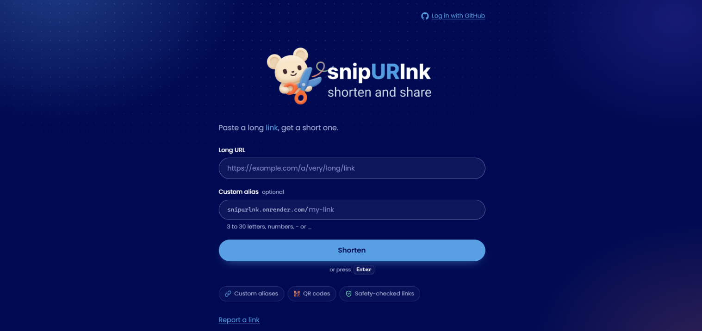
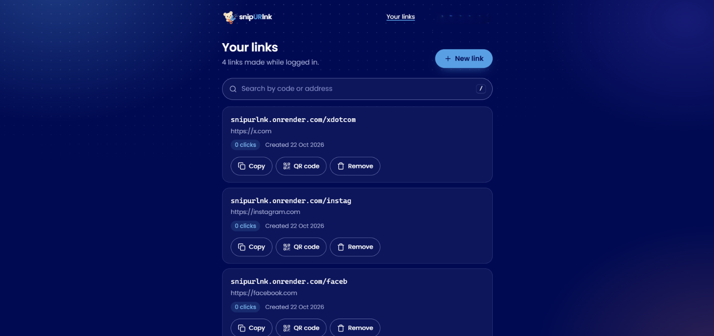
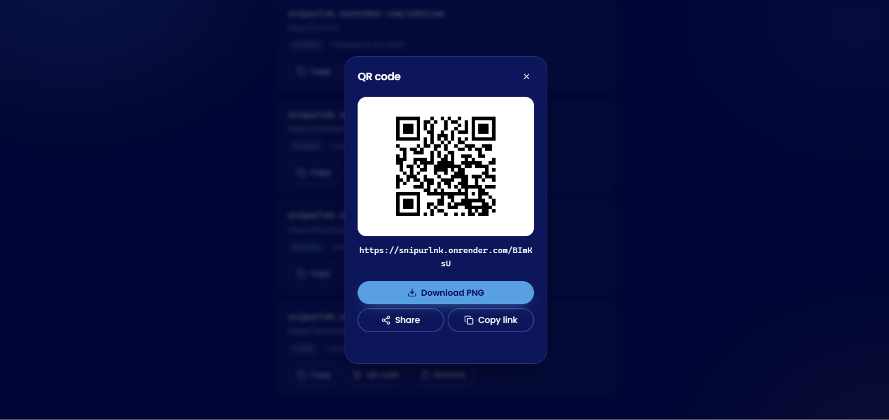
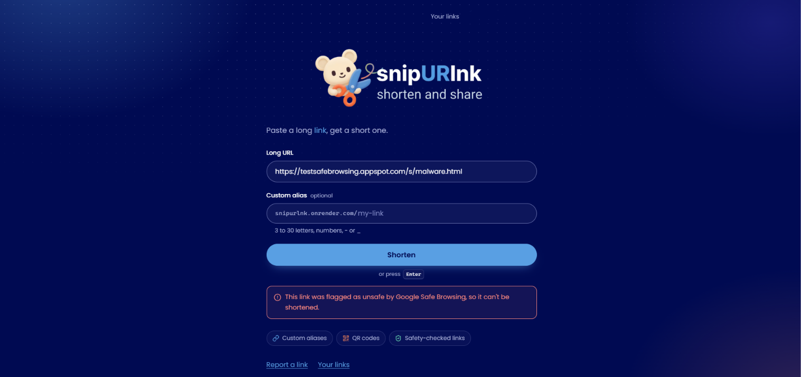
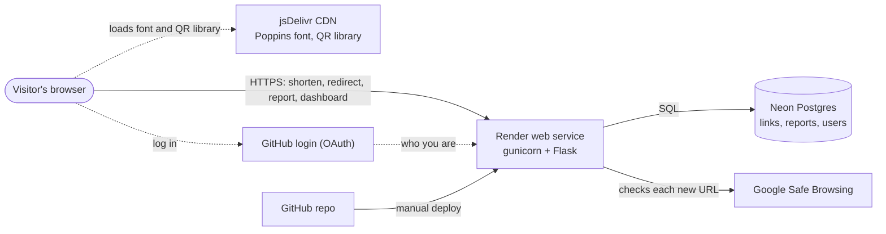

# snipURlnk

[](LICENSE)

A free URL shortener with custom aliases, QR codes, a link-safety check and optional GitHub login. Built with Flask and Postgres.

**Live demo: <https://snipurlnk.onrender.com>**

I built it as a learning project, one small tested step at a time. It runs on free hosting and is meant for friends and classmates, not heavy traffic.

> The free Render plan puts the app to sleep after 15 minutes without visitors. The first visit after that takes about 30 seconds (I measured 32.5 s).



| Your links dashboard | QR code popup | Friendly 404 page | Unsafe link refused |
|----------------------|---------------|-------------------|---------------------|
|  |  |  |  |

## Features

**Shortening**
- Random 6-character codes, or your own alias (3 to 30 letters, digits, `-` or `_`; case-insensitive; some words like `admin` are reserved)
- A taken code is never overwritten, and every submission creates its own new link
- Strict URL validation: only `http` and `https` with a real domain, a valid port, no spaces or control characters, at most 2,048 characters. A missing scheme is added for you (`example.com` becomes `https://example.com`), and the result card shows the address that was actually stored
- Copy, Open and QR code buttons on each new link. The QR popup also has Download PNG, Share (where the browser supports it) and Copy link
- Click counts for every link

**Accounts (optional)**
- Log in with GitHub. Anyone can still shorten links without logging in
- An account menu in the header shows who you are and links to Your links, Report a link and Log out
- Links made while logged in are yours. The **Your links** dashboard shows how many you have, lists them newest first (up to 200) with click counts and creation dates, and lets you Copy, show a QR code, or Remove each one. Remove asks for confirmation first
- With more than 3 links, a search box filters them by code or address (press `/` to jump to it)
- Only your numeric GitHub ID and username are stored: no email, no passwords

**Safety and abuse control**
- Every new link is checked against Google Safe Browsing. Links flagged as malware, phishing, unwanted software or potentially harmful apps are refused. If Google can't be reached, the link is allowed through and a warning is logged
- Rate limits per visitor: 10 new links per minute and 100 per day, 5 reports per minute and 20 per day, 120 requests per minute elsewhere
- Visitors can report a link from the home page, the 404 page or the account menu. I review reports with admin commands in the terminal

**Quality**
- One navy theme built from CSS variables, with text colours chosen for strong contrast
- A friendly 404 page whose countdown can be stopped (screen-reader friendly)
- Short toast messages ("Link copied", "Link removed"), and plain-language error messages, including a friendly one when the server fails
- A favicon and a link preview card for chat apps
- A pytest suite of 161 tests that runs against a separate test database

## Quick start (run it locally)

You need Python 3.13 (see [.python-version](.python-version)) and a free Postgres database from [Neon](https://neon.com).

**macOS / Linux**

```bash
git clone https://github.com/martinipolice/snipurlnk.git
cd snipurlnk
python3 -m venv venv
source venv/bin/activate
pip install -r requirements.txt
export DATABASE_URL='postgresql://...'
python app.py
```

**Windows PowerShell**

```powershell
git clone https://github.com/martinipolice/snipurlnk.git
cd snipurlnk
python -m venv venv
.\venv\Scripts\Activate.ps1
pip install -r requirements.txt
$env:DATABASE_URL = 'postgresql://...'
python app.py
```

If PowerShell refuses to run `Activate.ps1`, allow scripts for this window only with `Set-ExecutionPolicy -Scope Process -ExecutionPolicy Bypass` and try again.

Open <http://127.0.0.1:5000>. The tables are created automatically on first run. For auto-reload while developing, set `FLASK_DEBUG=1` (PowerShell: `$env:FLASK_DEBUG = '1'`) before starting.

The styles are served by the app itself. The Poppins font and the QR code library come from jsDelivr, so without internet the page falls back to a system font and the QR buttons are hidden; everything else works.

### Configuration

Treat every secret below like a password: keep it in environment variables, never commit it, and never paste it into chat or screenshots.

| Variable | Required | What it is for | If it is missing |
|----------|----------|----------------|------------------|
| `DATABASE_URL` | yes | Postgres connection string (contains the database password) | The app refuses to start (`DATABASE_URL is not set`) |
| `SAFE_BROWSING_API_KEY` | no | Turns on the link safety check. Google limits this API to non-commercial use | Links aren't checked, and a warning is logged |
| `SECRET_KEY`, `GITHUB_CLIENT_ID`, `GITHUB_CLIENT_SECRET` | no | Turn on login with GitHub. `SECRET_KEY` signs the session cookie | `/login` answers `503`; everything else still works |
| `RENDER` | no | Render sets it to `true`, which makes the session cookie `Secure` (HTTPS only) | The cookie also works over plain `http`, as it must locally |
| `FLASK_DEBUG` | no | `1` turns on auto-reload and the debugger with `python app.py`. Never on the live site | Normal mode |
| `TEST_DATABASE_URL` | for tests | A separate test database (see [Running the tests](#running-the-tests)) | The database and route tests are skipped |

**Setting up GitHub login locally:** on GitHub go to Settings, Developer settings, OAuth Apps, New OAuth App. Use `http://127.0.0.1:5000` as the homepage and `http://127.0.0.1:5000/login/github/callback` as the callback URL, and don't request any scopes. Make a key for `SECRET_KEY` with:

```bash
python -c "import secrets; print(secrets.token_hex(32))"
```

Never reuse that key on the live site. Always open the local site as `127.0.0.1`, not `localhost`, because the callback address must match exactly.

## How it works



**Creating a link**

1. The server trims the URL and adds `https://` if there is no scheme, then validates it. Anything invalid gets a `400`.
2. If you gave an alias, it must match the allowed pattern and not be reserved (`400`).
3. Google Safe Browsing is asked about the URL. A flagged URL is refused with a `400` and nothing is saved. If Google doesn't answer within 3 seconds, the link goes through.
4. The link is saved. With an alias, the server tries that code once and returns `409` if it is taken. Without one, it picks a random code and retries on a collision. If you are logged in, the link is stored with your user ID as its owner.
5. The reply is JSON with the code and the stored URL, which the page shows in the result card.

**Visiting a link:** the server looks up the code, adds 1 to its click count and redirects. Unknown or removed codes return the 404 page and change nothing.

**Logging in:** `/login` sends you to GitHub, which sends you back to `/login/github/callback` with proof of who you are. The server creates or finds your user and starts a fresh session. The session cookie holds only your user ID, signed with `SECRET_KEY`. It lasts 7 days, is `HttpOnly` and `SameSite=Lax`, and is `Secure` (HTTPS only) on the live site. Logging out is a `POST`.

### Routes

| Route | What it does |
|-------|--------------|
| `GET /` | The shortener page |
| `POST /shorten` | Creates a link from the form fields `url` and optional `alias`. Returns JSON `{"code": ..., "url": ...}`, where `url` is the normalised address that was stored. `400` for a bad URL or alias or a Safe Browsing match, `409` if the alias is taken, `429` over the rate limit |
| `GET /<code>` | `302` redirect to the original URL. `404` page if the code doesn't exist or was removed |
| `GET /report` | The report form |
| `POST /report` | Saves a report (fields `link` and optional `reason`). `400` without a link, `404` if the link doesn't exist, `429` over the rate limit |
| `GET /login` | Sends you to GitHub (`503` if login isn't set up) |
| `GET /login/github/callback` | Where GitHub sends you back. Starts your session and redirects home (`400` if the login fails) |
| `POST /logout` | Ends your session, `303` back home |
| `GET /dashboard` | Your links, newest first, up to 200. Never cached. Redirects to `/login` if you aren't logged in |
| `POST /remove/<code>` | Removes one of your links, `303` back to the dashboard. `404` if it isn't yours or is already gone; `303` to `/login` if you aren't logged in |

### Design decisions

- **One link per submission.** Submitting the same URL twice makes two links, so each person's link is independent and per-link features like click counts work.
- **Case-insensitive codes.** The `code` column is Postgres `citext`, so `MySite` and `mysite` are the same link and lookalike links can't be registered.
- **Removed, not deleted.** Removing a link sets a flag instead of deleting the row, so the code stays taken and the alias can't be claimed again.
- **Ownership is checked on the server.** The dashboard lists only your links, and Remove matches the code and the owner together. Someone else's link, a removed link and a missing link all give the same `404`, so nobody can probe which codes belong to others. Links made before accounts existed have no owner, so nobody can remove them from a dashboard.
- **GitHub login instead of passwords.** The app stores no passwords and no email, only a GitHub ID and a username.
- **Safe Browsing fails open and is checked once.** If Google is down, links are still created (the failure is logged), because I'd rather keep the site usable. A site that turns bad later is not caught, since checking on every visit would slow redirects and use up the quota. Every submitted URL is sent to Google.
- **Click counts include every redirect**, including link previews and prefetches. Filtering them out is a possible later improvement.
- **QR codes are made in the browser** with `qrcode-generator` (pinned to one version with an integrity hash, loaded from jsDelivr), so the server does no extra work. If the library doesn't load, the QR buttons disappear and the rest still works. Codes are always black on white, because inverted codes fail in many scanners.
- **The 404 countdown can be stopped.** A timed redirect can lock out slow readers, so there is a Stop button, a plain "go now" link, and one quiet announcement for screen readers instead of one per second.
- **Remove asks first.** A `<dialog>` names the link and explains that its code stays taken. Removal itself is a `POST`, and the `SameSite=Lax` cookie stops other sites from triggering it. "Link removed" is shown only after the server confirms.
- **No front-end framework.** The theme is CSS variables in [static/style.css](static/style.css), and the menus, toasts and QR popup are small plain-JavaScript files.

## Deployment

- **Host:** Render free web service (Singapore), started with `gunicorn app:app`, with deploys triggered manually after the tests pass
- **Database:** a Neon Postgres project separate from the one used for development. Before a release that changes tables, I make a Neon branch of it as a restore point. Table changes in `init_db()` only add things, so the previous version keeps working if I have to roll back
- **Settings:** the environment variables above are set on Render's Environment page. The live site has its own GitHub OAuth app (callback `https://snipurlnk.onrender.com/login/github/callback`) and its own `SECRET_KEY`
- **Python:** pinned in [.python-version](.python-version)
- **Visitor address:** Render adds three addresses to `X-Forwarded-For`, so the app trusts exactly three (`ProxyFix(x_for=3)`). I measured this on the live site, and a test checks that a faked header can't get around the rate limit
- **Rate-limit storage:** in memory, which is correct only with one gunicorn worker. Moving to several workers would need a shared store

## Admin commands

There is no admin page. Run these from the project folder, with `DATABASE_URL` pointing at the database you mean to change:

```bash
python admin.py reports          # list open reports, grouped by link
python admin.py remove <code>    # hide a link; visits show the 404 page
python admin.py dismiss <code>   # clear reports for a link you decided to keep
```

## Running the tests

```bash
pip install -r requirements-dev.txt
python -m pytest -q
```

There are 161 tests. The 52 validation and text-helper tests need no database and run in a fraction of a second:

```bash
python -m pytest -q tests/test_validation.py tests/test_text_helpers.py
```

The Safe Browsing tests use a fake network, so they never contact Google. The login tests use a fake GitHub. The database and route tests need a separate test database and skip themselves without one:

1. In Neon, create a branch of your database (for example `test`) and copy its connection string.
2. Set it as `TEST_DATABASE_URL`. This is a different variable from `DATABASE_URL`. In PowerShell, use single quotes: `$env:TEST_DATABASE_URL = 'postgresql://...'`
3. Mark it as a test database, once, in Neon's SQL Editor or any Postgres client:
   ```sql
   CREATE TABLE IF NOT EXISTS i_am_a_test_database (id INTEGER);
   ```

The tests empty the `reports`, `links` and `users` tables before every test, so there are three safety checks. They skip if `TEST_DATABASE_URL` is missing, refuse to run if it matches `DATABASE_URL`, and refuse to delete anything unless the `i_am_a_test_database` table exists. Never create that table in your real database. A full run takes about three to six minutes, mostly waiting on the remote database.

The tests check the HTML the server sends, but they don't run the page's JavaScript, so I also check changes in the browser.

## Project structure

```
snipurlnk/
├── app.py                    # Flask routes, login, dashboard, rate limits
├── shorten.py                # Validation, code generation, Postgres storage, users, owned links
├── safety.py                 # Google Safe Browsing check
├── admin.py                  # Review reports and remove links from the terminal
├── templates/
│   ├── _head.html            # Shared <head>: meta tags, favicon, font, styles, scripts
│   ├── _header.html          # Shared header: brand, login link or account menu
│   ├── _qr_dialog.html       # QR popup and the pinned QR library, shared by home and dashboard
│   ├── index.html            # Home page and its script
│   ├── dashboard.html        # Your links, with search, Copy, QR and Remove
│   ├── report.html           # Report form
│   └── 404.html              # Friendly "link not found" page
├── static/
│   ├── style.css             # The navy theme (CSS variables) and all layout
│   ├── ui.js                 # Dropdown menu keyboard handling and the / search shortcut
│   ├── toast.js              # Small corner messages, including one kept across a reload
│   ├── qr.js                 # Draws, downloads, shares and copies QR codes
│   ├── icons.svg             # Icon sprite used by every page
│   ├── logo.png              # Home page logo
│   ├── mascot.png            # Mascot in the header, 404 page and empty dashboard
│   ├── favicon.png           # Browser tab icon
│   └── share.png             # Link preview image (1200x630)
├── tests/
│   ├── conftest.py           # Test-database fixture and its safety checks
│   ├── test_database.py      # Storage, clicks, reports, users, ownership
│   ├── test_routes.py        # Every route, login, rate limits, page HTML
│   ├── test_safety.py        # Safe Browsing with a fake network
│   ├── test_text_helpers.py  # URL normalising, alias rules, code extraction
│   └── test_validation.py    # URL rules
├── docs/screenshots/         # Images used in this README
├── .gitignore
├── .python-version           # Python version used on Render
├── pytest.ini
├── requirements.txt          # What the app needs to run
├── requirements-dev.txt      # Adds the test tools
├── LICENSE
└── README.md
```

## Roadmap

Done: core shortening, Postgres storage, validation, custom aliases, rate limiting, report and remove, automated tests, deployment on Render and Neon, Safe Browsing, custom 404, QR codes, favicon and preview card, GitHub login, the dashboard with search, Copy, QR and Remove, the navy redesign, a round of small fixes, and the MIT license.

Next:
- [ ] Link expiry
- [ ] Speed up the test suite
- [ ] An accessibility pass

## What I learned

- **Moving from SQLite to Postgres is more than a new connection string.** Codes use `citext`, Postgres is stricter about `GROUP BY`, placeholders change from `?` to `%s`, and a failed insert needs a `rollback()` before the connection can be used again.
- **A test database must be impossible to confuse with the real one.** Separate `TEST_DATABASE_URL`, a refusal to run if it matches `DATABASE_URL`, and a marker table before anything is deleted. I also broke the code on purpose to watch the tests fail, because a test that can't fail proves nothing.
- **Measure instead of trusting the docs.** Render doesn't say how the visitor's address is passed on, so I measured it, set `ProxyFix(x_for=3)`, and wrote a test showing a faked header can't dodge the rate limit.
- **Decide what happens when a dependency is down.** For Safe Browsing I chose to fail open and wrote the trade-off down.
- **Let someone else handle passwords.** GitHub login meant no password storage or reset flow and almost no personal data. The OAuth `state` check blocks forged logins, and a signed cookie holding only a user ID is enough.
- **Check ownership on the server, every time.** Hiding a button isn't protection. Remove looks up the link and the owner together.
- **Back up before changing a live database.** The first accounts deploy added tables and columns to live data, so I made a Neon branch first.
- **My tests don't run my JavaScript.** After moving the QR code into a shared file, one leftover `let` declared the same name twice and the live Shorten button silently stopped working. I only saw it in the browser console. I added a test for that line and now check the console after editing any template.
- **Secrets stay out of code and chat.** They live in environment variables and Render's settings, and the Safe Browsing key is restricted to one API and sent in a header so it can't end up in a URL or a log.
- **Accessibility is part of "done".** A stoppable countdown, announcements made once instead of every second, and real `<dialog>` popups.
- **An AI assistant works best with small briefs.** I used Claude Code with one short, specific task at a time, then read its changes, ran the tests and checked the result in the browser myself before merging.

## License

snipURlnk is released under the MIT License. See [LICENSE](LICENSE) for the full text.
